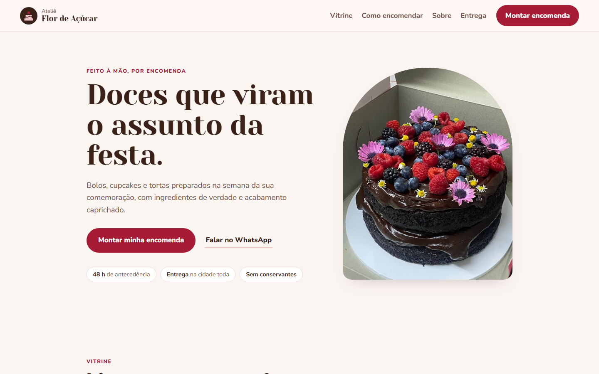

# Ateliê Flor de Açúcar, landing page para confeitaria

**Veja funcionando:** https://deborahdalonso.github.io/bakery-landing-demo/

Landing page para confeitaria que trabalha por encomenda. O destaque é a vitrine **Monte sua encomenda**: a cliente escolhe os doces e as quantidades, vê o total na hora e envia o pedido pronto pelo WhatsApp, com a lista de itens, os valores e espaço para a data da festa.

## O que tem na página

- Vitrine com bolos, bolos de festa, cupcakes e tortas, filtrada por categoria.
- Pedido mínimo respeitado nos doces vendidos por quantidade, como cupcakes de 6 em 6.
- Barra do pedido que acompanha a rolagem, com o total e o botão de enviar.
- Como encomendar, sobre a confeiteira, depoimentos, entrega, retirada e pagamento.
- Pensada primeiro para o celular, por onde a maioria das encomendas chega.

## Como foi feita

- HTML, CSS e JavaScript puros, sem WordPress ou construtor de sites.
- Fotos otimizadas para carregar rápido.
- Cores, textos, produtos e preços concentrados em poucos lugares, para adaptar a outra confeitaria rapidamente.

Marca, nomes, preços e depoimentos são fictícios.

Desenvolvido por [Deborah Dalonso](https://www.linkedin.com/in/deborah-dalonso-482099138).
